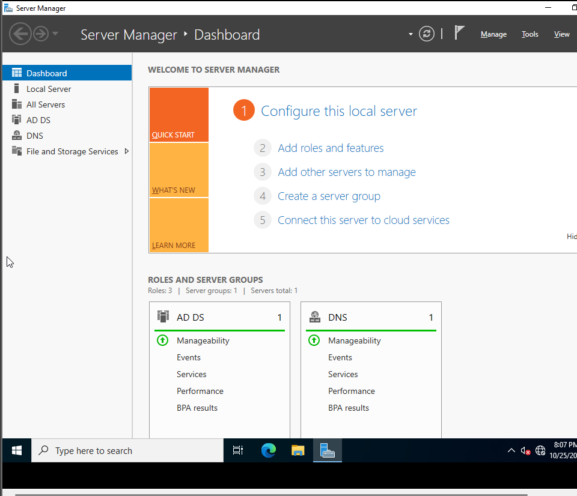
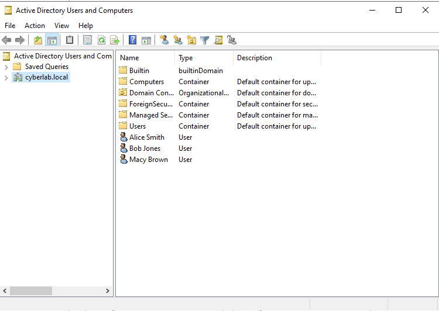
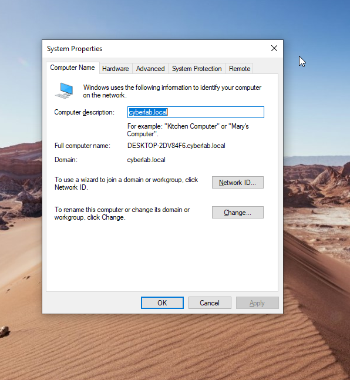
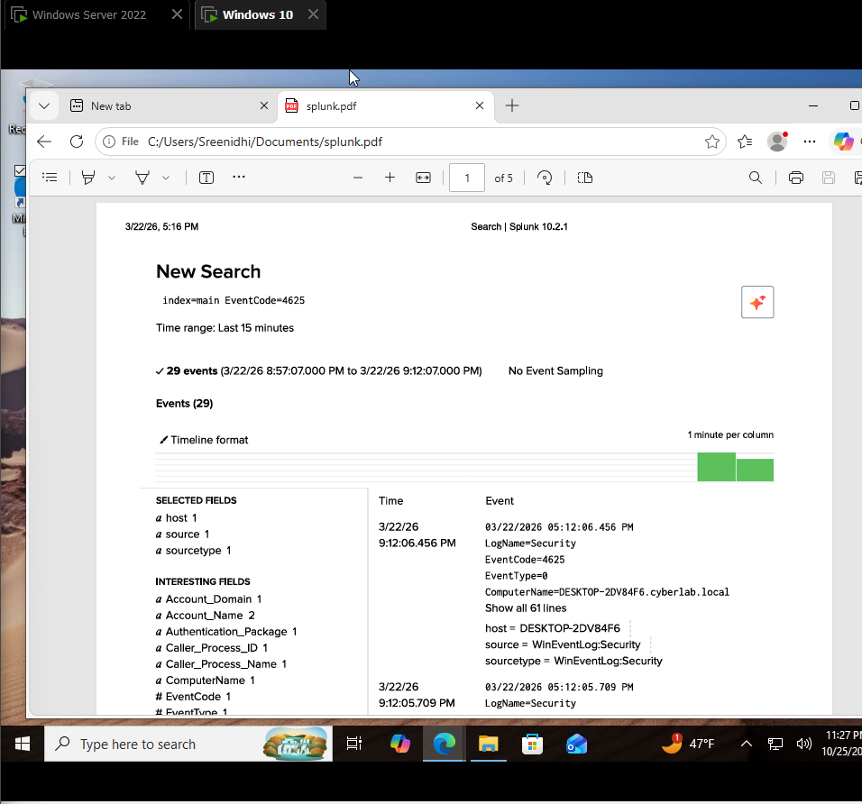
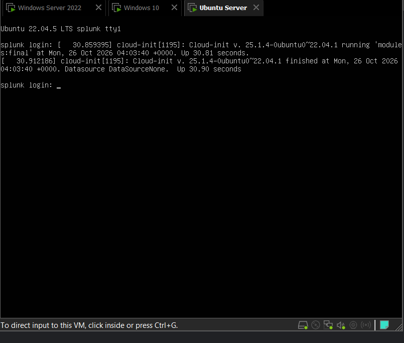
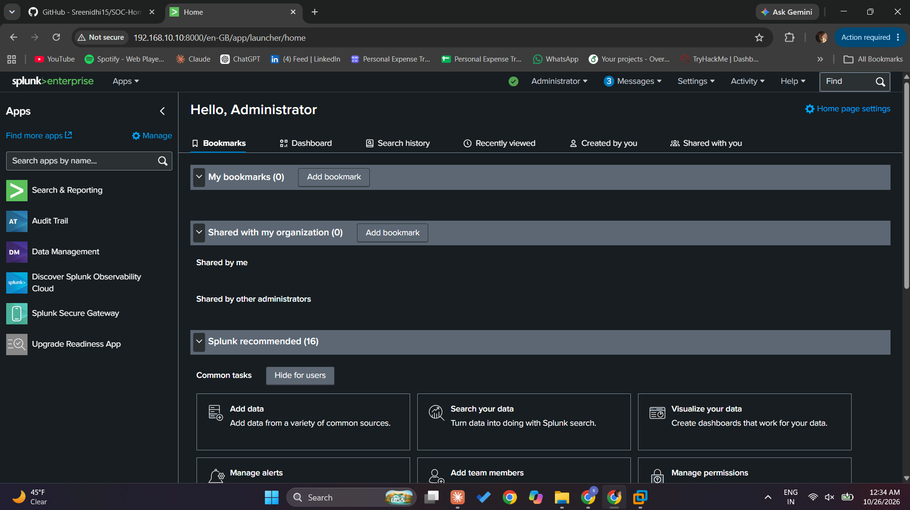
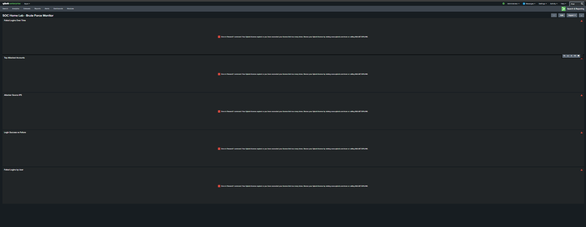

# SOC Home Lab - Fully Operational Security Operations Center

A complete, working Security Operations Center (SOC) home lab built with VMware, Active Directory, Splunk SIEM, and attack simulation capabilities. This lab demonstrates enterprise-grade security monitoring, threat detection, and incident response practices.

**Status:** ✅ **Fully Operational and Tested**

---

## 📋 Table of Contents

- [Overview](#overview)
- [Infrastructure Proof](#infrastructure-proof)
- [Architecture](#architecture)
- [Lab Setup](#lab-setup)
- [Active Directory Configuration](#active-directory-configuration)
- [Splunk SIEM Configuration](#splunk-siem-configuration)
- [Attack Simulation](#attack-simulation)
- [Detection & Alerting](#detection--alerting)
- [Dashboard](#dashboard)
- [Skills Demonstrated](#skills-demonstrated)

---

## 🎯 Overview

This project simulates a real-world enterprise environment to practice threat detection, log analysis, and incident response. The lab includes:

- **Windows Active Directory domain** with multiple user accounts
- **Splunk Enterprise SIEM** for centralized log collection and analysis
- **Windows 10 endpoint** with Splunk Universal Forwarder for log forwarding
- **Kali Linux attacker machine** for brute force attack simulation
- **Custom detection rules** and alerting for suspicious activities
- **Real-time dashboard** monitoring attack indicators

### Key Features

✅ **Endpoint Monitoring** - Sysmon-based Windows Security Event logging  
✅ **SIEM Integration** - Splunk Enterprise for centralized log analysis  
✅ **Attack Simulation** - Hydra-based brute force attacks for testing  
✅ **Custom Detection Rules** - Alert thresholds for suspicious activity  
✅ **Dashboard Visualization** - Real-time monitoring of security events  
✅ **Incident Response Practice** - MITRE ATT&CK aligned for blue team training  

---

## 📸 Infrastructure Proof

### Server Manager - Active Directory Domain Services Running

<div align="center">



Windows Server 2022 with AD DS and DNS services installed and operational.

</div>

---

### Active Directory Users and Computers

<div align="center">



SOC team users successfully created:
- **asmith** - Alice Smith (SOC Analyst)
- **bjones** - Bob Jones (SOC Analyst)  
- **mbrown** - Macy Brown (Security Manager)

Domain: `cyberlab.local`

</div>

---

### Windows 10 Endpoint - Domain Joined

<div align="center">



Windows 10 client successfully joined to `cyberlab.local` domain.

- **Computer Name:** DESKTOP-2DV84F6.cyberlab.local
- **Domain:** cyberlab.local
- **Status:** Domain membership confirmed

</div>

---

### Splunk Log Collection - EventCode=4625 Detected

<div align="center">



Splunk Enterprise successfully collecting Windows Security Event Logs showing:
- **EventCode=4625** - Failed Login attempts
- **Source:** DESKTOP-2DV84F6.cyberlab.local
- **Data Ingestion:** Working and parsing correctly

</div>

---

### Ubuntu Splunk Server - Successfully Booted

<div align="center">



Ubuntu 22.04.5 LTS running with Splunk service initialized.

</div>

---

### Splunk Web Interface - Admin Logged In

<div align="center">



Splunk Enterprise 10.2.1 web interface accessible and authenticated as admin.

</div>

---

### SOC Home Lab - Brute Force Monitor Dashboard

<div align="center">



Complete dashboard with all monitoring panels configured and visible:

- **Failed Logins Over Time** - Timeline chart
- **Top Attacked Accounts** - Bar chart visualization  
- **Attacker Source IPs** - Pie chart analysis
- **Login Success vs Failure** - Comparison metrics
- **Targeted Machines** - Machine-focused data
- **Failed Logins by User** - User activity tracking

</div>

---

## 🏗️ Architecture

```
┌─────────────────────┐          Attack          ┌──────────────────────┐
│   Kali Linux        │ ◄────────────────────►   │  Windows 10 (Target) │
│  192.168.10.250     │   SMB & RDP Brute Force  │  192.168.10.100      │
│  (Attacker)         │                          │  (cyberlab.local)    │
└─────────────────────┘                          └──────────────────────┘
         │                                                 │
         │                                    Log Forwarding via
         │                                    Universal Forwarder
         │                                                 │
         │                    ┌──────────────────────────┘
         │                    │
         └───────────────────┼────────────────────────┐
                             │                        │
                ┌────────────▼──────────┐  ┌──────────▼────────────┐
                │  Windows Server 2022  │  │  Ubuntu Server       │
                │  (AD Domain Controller)   │  (Splunk SIEM)      │
                │  192.168.10.7         │  │  192.168.10.10      │
                │  cyberlab.local       │  │  Splunk Enterprise  │
                │                       │  │  10.2.1             │
                └───────────────────────┘  └─────────────────────┘

NAT Network: 192.168.10.0/24
```

---

## 🔧 Lab Setup

### Network Configuration

| Machine | IP Address | Role | Operating System |
|---------|-----------|------|------------------|
| Kali Linux | 192.168.10.250 | Attacker | Kali Linux |
| Windows Server 2022 | 192.168.10.7 | Active Directory DC | Windows Server 2022 |
| Ubuntu Server | 192.168.10.10 | Splunk SIEM | Ubuntu 22.04.5 LTS |
| Windows 10 | 192.168.10.100 | Target Endpoint | Windows 10 |

**Network Type:** VMware NAT Network  
**Network Range:** 192.168.10.0/24

---

## 👥 Active Directory Configuration

### Domain Details

- **Domain Name:** `cyberlab.local`
- **Domain Controller:** Windows Server 2022 (192.168.10.7)
- **DSRM Password:** Network26
- **DNS:** Configured and operational

### Domain Users

| Username | Full Name | Password | Role |
|----------|-----------|----------|------|
| asmith | Alice Smith | Password123! | SOC Analyst |
| bjones | Bob Jones | Password123! | SOC Analyst |
| mbrown | Macy Brown | Password123! | Security Manager |

---

## 🔍 Splunk SIEM Configuration

### Splunk Enterprise Setup

- **Version:** Splunk Enterprise 10.2.1
- **Host:** Ubuntu Server (192.168.10.10)
- **Web UI:** `http://192.168.10.10:8000`
- **Admin Credentials:** admin / Network26

### Data Input Configuration

**Splunk Universal Forwarders installed on:**
- Windows 10 (192.168.10.100)
- Windows Server 2022 (192.168.10.7)

**Data Source:** `WinEventLog:Security` (Windows Security Event Logs)  
**Receiving Port:** 9997  
**Index:** endpoint  

### Monitored Event IDs

| Event ID | Description |
|----------|-------------|
| 4625 | An account failed to log on |
| 4624 | An account was successfully logged on |

---

## ⚔️ Attack Simulation

### Brute Force Attack Tool: Hydra

Attacks launched from Kali Linux (192.168.10.250) against domain-joined machines

#### SMB Brute Force

```bash
hydra -l asmith -P /usr/share/wordlists/rockyou.txt smb://192.168.10
```

- **Target:** SMB services on domain machines
- **Account:** asmith
- **Wordlist:** rockyou.txt (14+ million passwords)

#### RDP Brute Force

```bash
hydra -l bjones -P /usr/share/wordlists/rockyou.txt rdp://192.168.10
```

- **Target:** RDP on Windows endpoints
- **Account:** bjones
- **Result:** EventCode 4625 entries generated

---

## 🚨 Detection & Alerting

### Detection Query

```spl
index=endpoint EventCode=4625 
| stats count by src_ip, user, ComputerName 
| where count > 5 
| sort -count
```

### Splunk Alert Configuration

**Alert Name:** Brute Force Detected

| Setting | Value |
|---------|-------|
| Search | `index=endpoint EventCode=4625 \| stats count by src_ip \| where count > 10` |
| Schedule | Every hour (0 * * * *) |
| Trigger | When results > 0 |
| Action | Add to triggered alerts |
| Severity | High |

---

## 📊 Dashboard

### SOC Home Lab - Brute Force Monitor

**Dashboard Panels:**

| Panel | Type | Query |
|-------|------|-------|
| Failed Logins Over Time | Timechart | EventCode=4625 \| timechart count |
| Top Attacked Accounts | Bar Chart | EventCode=4625 \| top user |
| Attacker Source IPs | Pie Chart | EventCode=4625 \| top src_ip |
| Login Success vs Failure | Pie Chart | EventCode IN (4624,4625) \| stats count by EventCode |
| Targeted Machines | Bar Chart | EventCode=4625 \| top ComputerName |
| Failed Logins by User | Bar Chart | EventCode=4625 \| stats count by user |

---

## 🎓 Skills Demonstrated

### Security Operations Center (SOC)
- Complete SOC infrastructure design
- Centralized log management
- Real-time monitoring setup

### SIEM Administration  
- Splunk Enterprise deployment
- Index and input configuration
- Universal Forwarder deployment

### Active Directory
- Domain controller configuration
- User account management
- Domain security policies

### Threat Detection
- Windows Security Event analysis
- Attack pattern recognition
- Custom detection rules

### Attack Simulation
- Brute force attacks
- Real-world security testing
- Controlled environment exploitation

### Incident Response
- Event investigation
- Alert triage
- Timeline reconstruction

---

## 📂 Repository Contents

```
SOC-Home-Lab/
├── README.md                              # Complete documentation
├── screenshots/                           # All proof screenshots
│   ├── 01-server-manager-ad-ds.png
│   ├── 02-active-directory-users.png
│   ├── 03-windows-10-domain-joined.png
│   ├── 04-splunk-search-results.png
│   ├── 05-ubuntu-server-booted.png
│   ├── 06-splunk-home-login.png
│   └── 07-splunk-dashboard-complete.png
├── setup-notes/                           # Detailed setup instructions
├── splunk-queries/                        # SPL queries and alerts
└── .gitignore                             # Git configuration
```

---

## 🔐 Credentials Reference

### Kali Linux
- **Username:** sreenidhi
- **Password:** Network

### Windows Server 2022
- **Username:** Administrator
- **Password:** Network26

### Ubuntu Splunk Server
- **Username:** sreenidhi
- **Password:** Network

### Splunk Web Interface
- **URL:** http://192.168.10.10:8000
- **Username:** admin
- **Password:** Network26

### Windows 10
- **Username:** victim
- **Password:** Network

---

## ✅ Verification Checklist

- [x] Windows Server 2022 deployed with Active Directory
- [x] Active Directory domain configured (cyberlab.local)
- [x] Domain users created successfully
- [x] Windows 10 endpoint domain-joined
- [x] Ubuntu Server deployed with Splunk Enterprise
- [x] Splunk Universal Forwarders installed on endpoints
- [x] Windows Security Events being collected
- [x] Brute force attacks simulated with Hydra
- [x] EventCode=4625 (Failed Logins) detected in Splunk
- [x] Custom detection alert configured
- [x] Dashboard created with 6+ monitoring panels
- [x] Complete documentation with screenshots provided

---

**Lab Status:** ✅ **Fully Operational**  
**Last Updated:** October 26, 2026  
**All Components:** ✅ **Verified and Working**

🎓 **Complete SOC infrastructure for security training and incident response practice.**
